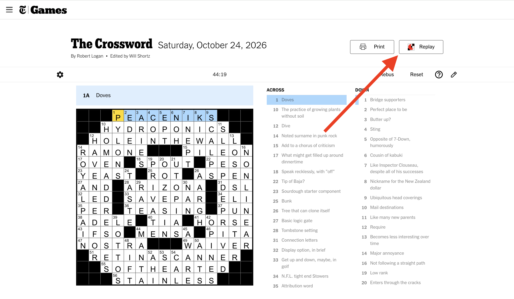
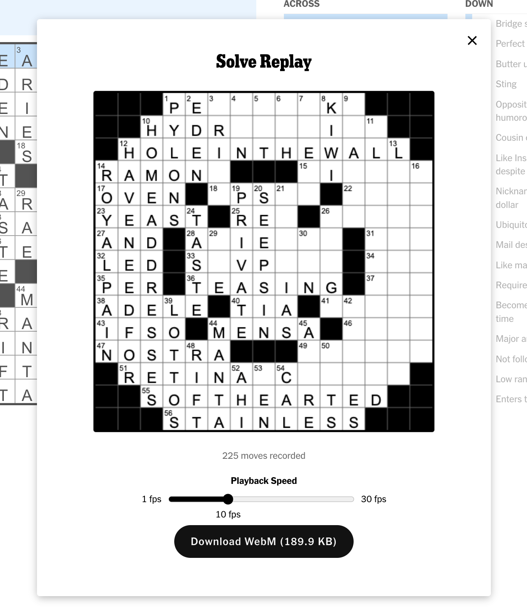

# Crossword Replay Browser Extension

This repo is for "NYT Crossword Replay" Chrome extension which allows for the recording, saving, and replay
of timelapse animations of crossword solves.

## How to Use

1. Add extension to Chrome by installing through web store or cloning repository and "Loading Unpacked"
extension from source files manually.
2. Go to https://www.nytimes.com/crosswords/game/daily website
3. Ensure you can see "Replay" button in top-right next to "Print" button

4. Fill in crossword squares to your hearts content, then click "Replay" button to view timelapse animation of solve.

## Features

1. Persists up to 5 MB of solve replay data in Chrome local storage (~300 crossword solves on average) so refreshing or closing and reopening page retains solve history from previous sessions. (After hitting this limit, the least recently updated puzzles will be pruned from storage).
2. Supports animation playback of 1 to 30 frames per second.
3. Allows downloading of solve timelapses in WebP video format at desired framerate.
4. Clearing full grid with "Clear" button will erase & reset solve recording history.

--- 

### Future Additions

1. More video formats (gif/wepb/mp4)
2. Firefox/Safari support
3. Maybe support other crossword sites ?
4. Control of active cell/word highlighting and other visual upgrades